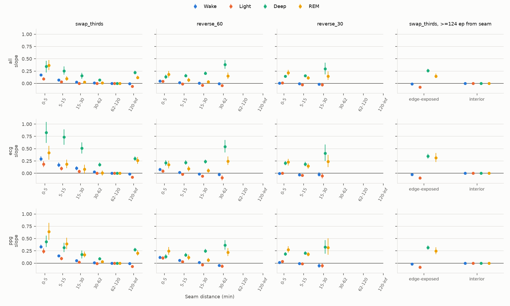
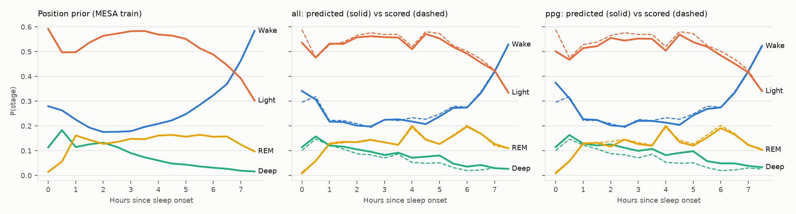

# Report: time-of-night shortcut audit of wav2sleep on MESA

Pre-registration: [`prereg.md`](prereg.md), committed in `9de68bb` before any intervention or
control was run. Amendment 1 (`7d0e73e`) was committed before any wav2sleep intervention was run.
Model: `hf://joncarter/wav2sleep`, snapshot `8b6e46ab`. Data: the 200 nights in wav2sleep's own
MESA test split, downloaded from NSRR and processed with wav2sleep's `1_ingest.py` and
`2a_create_splits_paper.py`. All four signals were present for all 200 nights.

## Verdicts

| Prediction (primary: relocation, onset prior, seam distance ≥ R = 72 epochs) | All signals | ECG only | PPG only |
|---|---|---|---|
| **P1 faithful (slope = 0)** | **Not confirmed** | **Not confirmed** | **Not confirmed** |
| **P2 shortcut (slope > 0, largest for Deep and REM)** | **Confirmed** | **Confirmed** | **Confirmed** |

The assay is valid by the pre-registered rule: the positive control's lower bounds exceed +0.10
and the negative control passes equivalence. The offset assay is valid by Amendment 1.

**wav2sleep shifts its Deep and REM probabilities in the direction of the position prior when
the same physiology is moved to a different part of the night.** It passes through about 8–20%
of the change in the prior. The onset-time positive control passes through 81–84%.

Two mechanisms produce the effect, and they are separable (see *Where the effect comes from*):
1. **Context within the mixer's ±62-min reach.** The effect is largest next to a seam and is
   gone by 62 min.
2. **Recording-edge exposure.** Content more than 2 h from any seam changes its Deep/REM
   probability when it is moved near the recording start or end, in the direction the prior
   predicts. This is a direct positional cue: the mixer zero-pads at the sequence boundaries.

Epochs that are far from every seam and every edge show a slope of exactly 0. This matches the
architecture, which gives such epochs identical mixer input.

## Step 0: receptive field

| | Value |
|---|---|
| Sequence mixer (checkpoint config) | 2 residual blocks × 5 layers, kernel 5, dilations 1–16 |
| Theoretical reach | **±124 epochs (±62 min)**; 249 epochs (2.1 h) total |
| Measured on checkpoint | gradient non-zero to exactly ±124 epochs, zero beyond |
| Effective RF R (pre-registered; unaltered test nights) | **72 epochs (36 min)**, IQR 62–80 |
| Signal encoders | ≈1.5 epochs |
| Whole-night path | InstanceNorm statistics over the whole 10-h frame (deterministic far-lag effect 0.03–0.06 on noise inputs); carries no order information |

The repo's default `wav2sleep.yaml` (kernel 7, 6 dilations) is not the released model.

## Primary slopes

OLS slope of null-corrected Δp on Δprior. 95% percentile CI from 2000 participant bootstraps.

**wav2sleep, relocations (`swap_thirds` only, since the block reversals have no epoch ≥ 72 from
a seam), onset prior; 194,789 epochs, 200 participants**

| Input | Wake | Light | Deep | REM |
|---|---|---|---|---|
| All signals | 0.004 [0.002, 0.007] | −0.021 [−0.027, −0.014] | **0.139** [0.122, 0.159] | **0.077** [0.060, 0.096] |
| ECG only | 0.011 [0.005, 0.018] | −0.028 [−0.039, −0.016] | **0.200** [0.177, 0.225] | **0.157** [0.120, 0.197] |
| PPG only | 0.007 [0.002, 0.013] | −0.017 [−0.027, −0.008] | **0.163** [0.143, 0.185] | **0.126** [0.099, 0.157] |

**wav2sleep, offsets pooled, start-anchored prior; 411,969 epochs, 159 participants**

| Input | Wake | Light | Deep | REM | Faithful rule | Shortcut rule |
|---|---|---|---|---|---|---|
| All signals | 0.002 [−0.004, 0.007] | −0.003 [−0.012, 0.006] | 0.038 [0.018, 0.056] | 0.003 [−0.010, 0.018] | met | not met |
| ECG only | 0.010 [−0.013, 0.041] | 0.012 [−0.015, 0.046] | −0.027 [−0.084, 0.030] | 0.013 [−0.027, 0.050] | met | not met |
| PPG only | −0.002 [−0.013, 0.010] | −0.011 [−0.027, 0.005] | 0.071 [0.041, 0.100] | −0.005 [−0.032, 0.021] | not met (Deep upper bound 0.1004) | not met |

Prepending 15–60 min of the night's own wake barely moves wav2sleep: it does not track time
since lights-out. Offsets were run on the nights whose first 15 / 30 / 60 min were all scored
Wake (159 / 135 / 98 nights).

## Controls (98 test nights with windowed features; seam radius 5 epochs)

| Model | Relocation slope: Wake / Light / Deep / REM | Offset slope (start prior): Deep / REM |
|---|---|---|
| Negative: windowed HRV/RRV/EDR, no time | 0.000 / 0.000 / 0.000 / 0.000 | 0.000 / 0.000 |
| Positive: + time since sleep onset | 0.40 / 0.35 / **0.81** / **0.84** | 0.000 / 0.001 (blind to offsets by construction) |
| Positive (Amendment 1): + time since recording start | 0.08 / 0.02 / **0.59** / **0.70** | **0.46** / **0.48** |

All positive-control CIs exclude +0.10 where marked bold. The assay detects an explicit
time-of-night feature, and Deep and REM are where it shows most. wav2sleep's slopes are
positive but well below either positive control.

## Where the effect comes from

*Slope by seam distance for relocations (onset prior), per input subset. Right column:
`swap_thirds` epochs ≥124 epochs from every seam, split by whether they are within 124 epochs
of either night's recording edges. Bins where Δprior barely varies are omitted. Percentile CIs
can exclude the point estimate; bars are clipped at 0.*

- **Seam-adjacent context.** For `swap_thirds`, the Deep slope falls from 0.34 (all signals;
  0.83 ECG-only) at 0–5 min from a seam to 0.07 at 30–62 min, and to 0.000 at 62–120 min. That
  is the mixer's reach. A relocated epoch is pulled toward what its new neighbours imply, and
  that correlates with the position prior. Block reversals, where every epoch is within 30 min
  of a seam, show the same effect throughout.
- **Edge exposure.** At ≥124 epochs from any seam, edge-exposed epochs have slopes of Deep
  0.26 / 0.35 / 0.32 and REM 0.15 / 0.31 / 0.25 (all / ECG / PPG). Interior epochs are 0.000.
  The 120+ min bin in the left column is this same edge effect.
- **Caveat on separating the two.** Moving an epoch next to the recording start both removes its
  preceding context and exposes it to padding. The audit cannot separate "less context" from
  "padding means early night". It can say that the change follows the position prior.

## Stage by position

*Left: position prior P(stage | time since sleep onset) from the 1541 MESA training nights.
Middle and right: wav2sleep's mean predicted probability (solid) vs scored frequency (dashed) on
the 200 unaltered test nights, all signals and PPG only.* On unaltered nights the model tracks
the scored time course closely. In the second half of the night it over-predicts Deep slightly.

## Accuracy and Cohen's κ against the moved labels (wav2sleep, pooled epochs)

| Condition | κ all | κ ECG | κ PPG | Acc all |
|---|---|---|---|---|
| Unaltered | 0.790 | 0.710 | 0.731 | 0.867 |
| Literal null 30 / 60 | 0.790 | 0.710 | 0.731 | 0.867 |
| Jittered null 30 | 0.790 | 0.709 | 0.728 | 0.867 |
| Swap thirds | 0.779 | 0.679 | 0.706 | 0.861 |
| Reverse 60-min blocks | 0.754 | 0.649 | 0.677 | 0.845 |
| Reverse 30-min blocks | 0.730 | 0.619 | 0.648 | 0.832 |

Reordering costs up to 0.06 κ (all signals) and 0.09 κ (ECG only). Offset rows are not
comparable with the unaltered row: they cover only nights with long initial wake, and the
prepended wake epochs are easy to classify.

**Null checks.** The literal null is bit-identical to the unaltered night (max |Δp| = 0 for every
subset and block size). The jittered nulls change predictions by a mean |Δp| ≤ 0.016
(Light, 30-min blocks, ECG), and by ≤ 0.004 for the nulls matched to `swap_thirds`.

## Robustness: alternative preprocessing (secondary, pre-registered)

The same 200 nights from a previously extracted copy (band-pass filtered, ±3 SD clipped,
z-scored; PPG and ECG only) give the same relocation result. Shortcut confirmed, faithful not:
Deep 0.200 / 0.205 and REM 0.172 / 0.175 (ECG / PPG). Edge-exposed Deep 0.35 / 0.39; interior
0.000. The offset result differs: PPG Deep 0.120 [0.078, 0.164], ECG Deep −0.072
[−0.117, −0.021]. This is a mixed offset response, not a clean null.

## Deviations and notes

1. **Amendment 1** (before any wav2sleep intervention): third control, time since recording
   start. Pre-registered in `prereg.md`.
2. **Loader fix before interventions** (`7af8e48`). A night now ends where the ingest's zero fill
   begins, not at the last scored epoch. After the fix, my input path matches wav2sleep's own
   `ParquetDataset` to ≤ 7e-4 in P(stage), and reruns are bit-identical. The commit message also
   lists an `analysis.py` change that was already in `9de68bb`.
3. **Post-hoc, presentation only.** After the first slope figure was unreadable, slopes are now
   reported as not identified when the SD of Δprior in a bin is < 0.005, and the figure plots
   relocations only. No primary estimate or verdict changed.
4. **Controls use a different label source**: the MESA actigraphy-overlap release, available for
   98 of the 200 test nights. Feature windows that straddle a seam were not recomputed, so
   control epochs within 5 epochs of a seam are excluded, as pre-registered.
5. **Most nights fill the 10-h frame** (median scored length 9.99 h). Offsets therefore push the
   last 15–60 min out of the frame, as pre-registered.

## Reproduce

See [`README.md`](README.md). Per-participant data and outputs (`results/`) are not in this
repository (NSRR data-use agreement).
